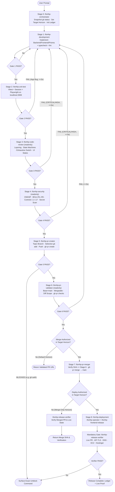
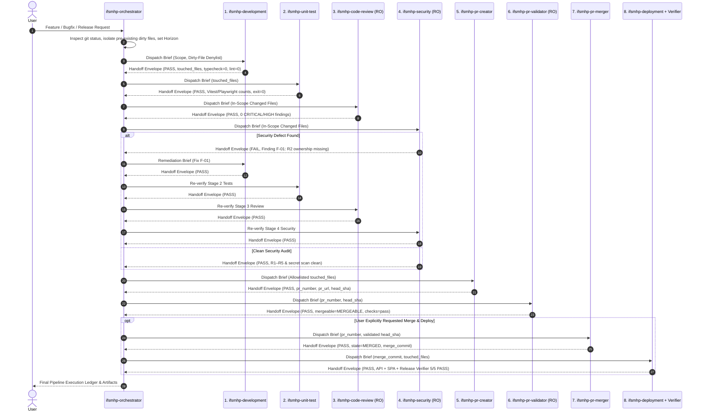

# IFSMHP End-to-End Agentic SDLC Workflow

**Document status:** Authoritative multi-agent software delivery specification  
**Scope:** End-to-end autonomous pipeline from feature/bugfix request → implementation → automated testing → independent code review → security audit → pull request creation → pull request validation → pull request merge → production deployment & live release verification.

---

## Table of Contents

1. [Executive Overview](#1-executive-overview)
2. [Generative AI & Agentic Engineering Principles](#2-generative-ai--agentic-engineering-principles)
3. [System Topology & Artifact Map](#3-system-topology--artifact-map)
4. [End-to-End Orchestration Flow & Sequence](#4-end-to-end-orchestration-flow--sequence)
5. [Connected Skills, Rules & Domain Knowledge](#5-connected-skills-rules--domain-knowledge)
6. [Handoff Protocol & Data Contracts](#6-handoff-protocol--data-contracts)
7. [Stage-by-Stage Reference (Stages 0 → 8 + Specialists)](#7-stage-by-stage-reference-stages-0--8--specialists)
8. [Bounded Reflexion, Self-Healing & Escalation State Machine](#8-bounded-reflexion-self-healing--escalation-state-machine)
9. [Governance Horizons & Human-in-the-Loop (HITL) Boundaries](#9-governance-horizons--human-in-the-loop-hitl-boundaries)
10. [Environment, Database & Production Safety Matrix](#10-environment-database--production-safety-matrix)
11. [Invocation Guide & End-to-End Walkthrough](#11-invocation-guide--end-to-end-walkthrough)
12. [Troubleshooting & Operational Recovery](#12-troubleshooting--operational-recovery)

---

## 1. Executive Overview

The IFSMHP platform (`backend/` Express + Prisma + MySQL, `frontend/` React 18 + Vite + TypeScript) is a gated professional workflow system where broken authorization, leaked PII, or unsafe production database commands carry severe institutional impact.

To eliminate single-agent blind spots, context-window degradation, and unverified deployments, this repository uses a **Deterministic Supervisor-Worker Agentic Pipeline**. A central orchestrator (`ifsmhp-orchestrator`) holds the complete functional blueprint, connected skills, and pipeline state ledger, dispatching **specialized subagents strictly one by one** and verifying machine-readable evidence gates before advancing to the next stage.

| Pipeline Phase | Agents Involved | Guarantee Provided |
|---|---|---|
| **Orchestration (Stage 0)** | `ifsmhp-orchestrator` | Worktree isolation, branch safety, sequential routing, gate verification |
| **Build & Prove (Stages 1–2)** | `ifsmhp-development` → `ifsmhp-unit-test` | Clean architecture, `typecheck` + `lint` pass, Vitest/Playwright proof on `:3308` |
| **Independent Audit (Stages 3–4)** | `ifsmhp-code-review` → `ifsmhp-security` | `readonly` fresh-context review of state machines, TypeScript rules, OWASP, and BOLA `R1`–`R5` |
| **PR Lifecycle (Stages 5–7)** | `ifsmhp-pr-creator` → `ifsmhp-pr-validator` → `ifsmhp-pr-merger` | Secret-free selective staging, conflict/CI gate validation, TOCTOU-safe merge to `main` |
| **Release & Live Proof (Stage 8)** | `ifsmhp-deployment` (`ifsmhp-operator` + `ifsmhp-frontend-release` + `ifsmhp-release-verifier`) | Safe `db:deploy` on EC2/RDS, prod SPA bundle check, DNS/TLS/Hostinger live verification |

---

## 2. Generative AI & Agentic Engineering Principles

The workflow implements six core standards from modern Generative AI and multi-agent systems engineering:

### 2.1 Hub-and-Spoke Supervisor Topology (No Uncontrolled Peer Chaining)
Worker subagents never hand off directly to arbitrary peers. Every stage reports back to `ifsmhp-orchestrator`. Centralizing state transitions in the supervisor prevents prompt drift, infinite agent loops, and lost error context.

### 2.2 Context Window Isolation & Zero Confirmation Bias
Each subagent invocation via Cursor's `Task` tool starts in a **fresh, isolated context window** without the author's intermediate trial-and-error reasoning. When `ifsmhp-code-review` (Stage 3) and `ifsmhp-security` (Stage 4) inspect a diff, they evaluate the code objectively against `docs/architecture.md` rather than rationalizing shortcuts made during coding.

### 2.3 Principle of Least Privilege (`readonly: true`)
Audit and validation subagents (`ifsmhp-code-review`, `ifsmhp-security`, `ifsmhp-pr-validator`) declare `readonly: true` in their frontmatter. Cursor enforces write-blocking at the harness level—these agents cannot silently mutate files or run state-altering shell commands.

### 2.4 Contract-First Inter-Agent Communication
Natural-language summaries are ambiguous. Communication between the orchestrator and workers uses two strict schemas defined in [`.cursor/skills/ifsmhp-sdlc-pipeline/CONTRACTS.md`](../.cursor/skills/ifsmhp-sdlc-pipeline/CONTRACTS.md):
- **Input:** `Pipeline Dispatch Brief` (explicit scope, branch, untouched dirty files, prior gate evidence, and remediation items).
- **Output:** `Stage Handoff Envelope` (YAML record of `verdict`, `touched_files`, `commands_executed` with exit codes, `gate_checks`, `findings`, and `artifacts`).

### 2.5 Bounded Reflexion & Mandatory Re-Verification
When a test, review, security, or PR validation gate returns `FAIL`, the orchestrator triggers a **bounded self-healing loop** (capped at **3 remediation attempts** per gate). Crucially, any code change made in Stage 1 to fix a Stage 3 or Stage 4 finding **must re-run from Stage 2 (`ifsmhp-unit-test`) onward**, ensuring security fixes cannot break unit tests and test fixes cannot introduce security regressions.

### 2.6 Policy-Driven Human-in-the-Loop (HITL) Gates
Ordinary engineering steps proceed autonomously without interrupting the user. Execution pauses **only** at explicit governance horizons (e.g., stopping at a validated PR unless merge/deploy was requested) or critical infrastructure boundaries (e.g., production data deletion, DNS changes, certificate replacement).

---

## 3. System Topology & Artifact Map

```text
Ifsmhp_new/
├── AGENTS.md                                           # Root multi-agent manifest & quick-start index
├── .cursor/
│   ├── rules/
│   │   └── ifsmhp-agents.mdc                           # Always-applied rule binding sessions to the pipeline
│   ├── skills/
│   │   ├── ifsmhp-sdlc-pipeline/
│   │   │   ├── SKILL.md                                # 8-stage pipeline orchestration protocol & horizons
│   │   │   └── CONTRACTS.md                            # Dispatch Brief & Handoff Envelope YAML schemas
│   │   └── ifsmhp-operate/
│   │       └── SKILL.md                                # Local setup (:3308, :4000, :5173), build & deploy steps
│   └── agents/
│       ├── ifsmhp-orchestrator.md                      # [Stage 0] Master Supervisor & Gate Verifier
│       ├── ifsmhp-development.md                       # [Stage 1] Full-stack coding, typecheck & lint
│       ├── ifsmhp-unit-test.md                         # [Stage 2] Vitest, session & Playwright testing
│       ├── ifsmhp-code-review.md                       # [Stage 3] Independent code review (readonly)
│       ├── ifsmhp-security.md                          # [Stage 4] OWASP & BOLA R1–R5 audit (readonly)
│       ├── ifsmhp-pr-creator.md                        # [Stage 5] Branch isolation, clean commit & PR open
│       ├── ifsmhp-pr-validator.md                      # [Stage 6] PR diff, mergeability & CI gate (readonly)
│       ├── ifsmhp-pr-merger.md                         # [Stage 7] SHA-verified merge into main
│       ├── ifsmhp-deployment.md                        # [Stage 8] Production rollout coordinator
│       ├── ifsmhp-operator.md                          # [Specialist] Local/EC2 runtime, MySQL & db:deploy
│       ├── ifsmhp-frontend-release.md                  # [Specialist] Prod SPA build & dist publish
│       └── ifsmhp-release-verifier.md                  # [Specialist] Live PR, TLS, DNS, EC2 & Hostinger check
└── docs/
    ├── agentic-workflow.md                             # This end-to-end specification
    ├── architecture.md                                 # Domain model, RBAC, BOLA R1–R5, state machines, I.1–I.17
    ├── application-flow.md                             # Request lifecycle, auth/OTP, file streaming
    ├── operations.md                                   # Environment config, Windows Prisma rules, AWS RDS/EC2
    └── api.md                                          # /api/v1 REST contracts & response envelopes
```

---

## 4. End-to-End Orchestration Flow & Sequence

### 4.1 Pipeline Control-Flow Diagram



### 4.2 Chronological Interaction Sequence



---

## 5. Connected Skills, Rules & Domain Knowledge

Every agent in the pipeline is grounded in shared repository rules and skills so domain invariants never have to be guessed:

| Artifact | Type | How It Connects to the Pipeline |
|---|---|---|
| `.cursor/rules/ifsmhp-agents.mdc` | Always-Applied Workspace Rule | Automatically injected into every Cursor agent session; mandates routing code/release work through `ifsmhp-orchestrator` and enforces critical production guardrails. |
| `no-inline-imports` & `typescript-exhaustive-switch` | Always-Applied Team Rules | Enforced during coding by `ifsmhp-development` (Stage 1) and audited for compliance by `ifsmhp-code-review` (Stage 3). |
| `review-playwright-pr` & `proceed-without-permission` | Global Rules | Govern autonomous step-by-step progression, browser verification of UI empty/error states, and stopping at open PRs unless merge/deploy was requested. |
| `.cursor/skills/ifsmhp-sdlc-pipeline/SKILL.md` | Project Skill | Defines the 8-stage topology, target horizons (`STAGE_6_PR_VALIDATED`, `STAGE_7_PR_MERGED`, `STAGE_8_DEPLOYED`), and orchestrator execution protocol. |
| `.cursor/skills/ifsmhp-sdlc-pipeline/CONTRACTS.md` | Contract Specification | Defines the exact `Pipeline Dispatch Brief`, `Stage Handoff Envelope`, `CRITICAL`/`HIGH`/`MEDIUM`/`LOW` severity rules, and gate checklists. |
| `.cursor/skills/ifsmhp-operate/SKILL.md` | Project Skill | Provides exact commands for `ifsmhp-mysql` (`:3308`), Windows Prisma DLL lock handling, `npm run dev` (`:4000`/`:5173`), `npm test`, and `db:deploy`. |
| `docs/architecture.md` & `docs/application-flow.md` | Architecture Specs | Supply RBAC matrices, BOLA rules `R1`–`R5`, workflow state machines (§H.1–H.4), security controls `I.1`–`I.17`, and Member ID `IFSMHP-NNNNNN` rules. |

---

## 6. Handoff Protocol & Data Contracts

Because subagents do not share conversation memory, **context transfer is explicit and structured**.

### 6.1 Orchestrator → Subagent Input (`Pipeline Dispatch Brief`)

Passed in the `Task` prompt every time `ifsmhp-orchestrator` launches a stage subagent:

```markdown
## Pipeline Dispatch Brief
- **Pipeline Run ID:** feat/publication-unpublish-audit
- **Current Stage:** 4 — Security Audit
- **Target Horizon:** STAGE_6_PR_VALIDATED
- **User Objective:** Record reviewer reason in AuditLog when unpublishing an approved publication
- **Working Branch:** feat/publication-unpublish-audit (Base: `main`)
- **Pre-existing Dirty Files (DO NOT STAGE/TOUCH):** backend/services/razorpay.service.ts, frontend/src/services/razorpayCheckout.ts
- **In-Scope Changed Files:** backend/validators/publication.validators.ts, backend/services/publication.service.ts, backend/tests/admin-publications.test.ts
- **Prior Gate Evidence Summary:**
  - Stage 1 (Dev): PASS (typecheck exit 0, lint exit 0)
  - Stage 2 (Unit Test): PASS (admin-publications.test.ts 14/14 passed)
  - Stage 3 (Code Review): PASS (0 CRITICAL/HIGH findings)
- **Remediation Feedback (if re-run):** none
- **Required Instruction File:** Read `.cursor/agents/ifsmhp-security.md` and return the canonical `Stage Handoff Envelope`.
```

### 6.2 Subagent → Orchestrator Output (`Stage Handoff Envelope`)

Returned at the end of every subagent's response and verified by `ifsmhp-orchestrator`:

```yaml
handoff_envelope:
  stage: "4"
  agent: "ifsmhp-security"
  verdict: "PASS" # PASS | FAIL | BLOCKED
  branch: "feat/publication-unpublish-audit"
  head_sha: "uncommitted"
  touched_files:
    - "backend/validators/publication.validators.ts"
    - "backend/services/publication.service.ts"
    - "backend/tests/admin-publications.test.ts"
  commands_executed:
    - cmd: "git diff -- backend/validators/publication.validators.ts backend/services/publication.service.ts"
      exit_code: 0
      summary: "Inspected strict Zod schema, ADMIN role gate, AuditLog metadata, and public query filter"
  gate_checks:
    - check: "BOLA & RBAC (R1-R5, I.1)"
      status: "PASS"
      evidence: "Route gated by requireRole('ADMIN'); unpublish immediately hides from /api/v1/public/publications"
    - check: "Mass Assignment & PII (I.2, I.13)"
      status: "PASS"
      evidence: "Zod .strict() schema accepts only reason string (1..1000 chars); internal notes excluded from public serializer"
    - check: "Secret Hygiene"
      status: "PASS"
      evidence: "Zero credentials or .env changes in diff"
  findings: []
  artifacts:
    pr_number: null
    pr_url: null
    merge_commit: null
    deploy_targets: []
  next_recommended_stage: "ifsmhp-pr-creator"
```

### 6.3 Finding Severity Taxonomy

| Severity | Examples | Gate Impact |
|---|---|---|
| `CRITICAL` | Missing ownership check (`R2`/`R3`), leaked `.env`/secret, raw SQL injection, failing test/build, prod DB hazard | **Immediate `FAIL`** — blocks promotion |
| `HIGH` | Missing Zod `.strict()`, skipped state-machine transition, inline import, non-exhaustive switch, missing negative auth test, broken UI error/empty state | **`FAIL`** — loops back to Stage 1 |
| `MEDIUM` | Minor query inefficiency, edge-case assertion improvement within touched code | Non-blocking unless widespread; noted in PR |
| `LOW` / `INFO` | Naming suggestion or future enhancement outside current scope | Recorded in ledger only; no code churn |

---

## 7. Stage-by-Stage Reference (Stages 0 → 8 + Specialists)

### Stage 0 — Master Orchestrator (`ifsmhp-orchestrator`)
- **File:** `.cursor/agents/ifsmhp-orchestrator.md` | **Mode:** Read/Write Supervisor
- **Responsibilities:**
  1. Snapshots `git status -sb` to isolate pre-existing uncommitted files in the developer's workspace.
  2. Determines the **Target Horizon** (`STAGE_6_PR_VALIDATED`, `STAGE_7_PR_MERGED`, or `STAGE_8_DEPLOYED`).
  3. Maintains a live `TodoWrite` progress checklist across active stages.
  4. Dispatches Stages 1 → 8 one at a time, validates each `handoff_envelope`, executes remediation loops on `FAIL`, and compiles the final audit ledger.

### Stage 1 — Development Coding Agent (`ifsmhp-development`)
- **File:** `.cursor/agents/ifsmhp-development.md` | **Mode:** Read/Write
- **Responsibilities:**
  1. Ensures work happens on a dedicated topic branch (`feat/...`, `fix/...`, `chore/...`), never committing to `main`.
  2. Implements changes following strict IFSMHP backend layering (`routes → middleware/validators → controllers → services → prisma`) and React + Tailwind + Zod frontend patterns.
  3. Enforces top-of-file imports, exhaustive `never` switches, additive Prisma migrations, Windows Prisma DLL stop/generate/restart handling, and UI loading/empty/error states.
  4. Runs `npm run typecheck` and `npm run lint` until both exit `0`, smoke-testing running API (`:4000`) / UI (`:5173`) flows.

### Stage 2 — Unit & Integration Testing Agent (`ifsmhp-unit-test`)
- **File:** `.cursor/agents/ifsmhp-unit-test.md` | **Mode:** Read/Write
- **Responsibilities:**
  1. Verifies `DATABASE_URL` targets local MySQL (`localhost:3308` / `*_test`), never production RDS.
  2. Authors/updates Vitest + Supertest suites (`backend/tests/*.test.ts`), session tests (`npm --prefix frontend run test:session`), and Playwright specs (`npm run test:e2e` / `test:*:browser`) covering:
     - Happy path + `AuditLog` / `*StatusHistory` rows
     - Validation failures (`400`/`422`) and illegal state transitions (`409`)
     - Authorization & BOLA (`401` unauthenticated, `403` `PENDING`/role mismatch, `404` non-owner member resource, stripped `reviewNotes` / private PII)
  3. Re-runs `typecheck` and `lint` on touched test files and returns exact test pass counts.

### Stage 3 — Code Review Agent (`ifsmhp-code-review`)
- **File:** `.cursor/agents/ifsmhp-code-review.md` | **Mode:** `readonly: true`
- **Responsibilities:**
  1. Audits the complete in-scope diff in a clean context window.
  2. Checks controller/service boundary purity, transaction atomicity (`prisma.$transaction`), post-commit email dispatch, Member ID `IFSMHP-NNNNNN` invariants, `no-inline-imports`, `typescript-exhaustive-switch`, UI state completeness, and non-tautological test assertions.
  3. Emits `PASS` only when `CRITICAL == 0` and `HIGH == 0`.

### Stage 4 — Security Audit Agent (`ifsmhp-security`)
- **File:** `.cursor/agents/ifsmhp-security.md` | **Mode:** `readonly: true`
- **Responsibilities:**
  1. Performs an adversarial security review against OWASP Top 10 and `docs/architecture.md` §B.3 (`R1`–`R5`) + §I (`I.1`–`I.17`):
     - **R1:** Live `User.status === 'ACTIVE'` enforcement
     - **R2:** Server-side record ownership check (`record.ownerId`)
     - **R3:** Parent-record authorization on file/attachment streams
     - **R4 & I.13:** Default-deny public/member/admin serializers
     - **R5:** `404` on non-owned member resources to prevent enumeration
     - **I.2–I.17:** Strict Zod schemas, magic-byte file upload checks, constant-time HMAC webhook verification, XSS/SSRF prevention, and zero hardcoded secrets.

### Stage 5 — Pull Request Creation Agent (`ifsmhp-pr-creator`)
- **File:** `.cursor/agents/ifsmhp-pr-creator.md` | **Mode:** Read/Write
- **Responsibilities:**
  1. Stages **only** allowlisted `In-Scope Changed Files` (`git add -- <files>`), strictly excluding `.env`, keys, `uploads/`, `dist/`, and pre-existing dirty files.
  2. Performs a final secret scan on `git diff --cached`.
  3. Creates a structured commit, pushes `-u origin <branch>`, and opens/updates a GitHub PR against `main` via `gh pr create` with architecture, security, test, and rollout documentation.

### Stage 6 — Pull Request Validation Agent (`ifsmhp-pr-validator`)
- **File:** `.cursor/agents/ifsmhp-pr-validator.md` | **Mode:** `readonly: true`
- **Responsibilities:**
  1. Queries live GitHub PR state via `gh pr view` and `gh pr checks`.
  2. Verifies `state == OPEN`, `isDraft == false`, `baseRefName == main`, `mergeable == MERGEABLE`, exact `headRefOid` match, clean PR file list, and passing CI checks (or verified local `typecheck` + `lint` + `test` + `build` when no remote workflow is attached).

### Stage 7 — Pull Request Merge Agent (`ifsmhp-pr-merger`)
- **File:** `.cursor/agents/ifsmhp-pr-merger.md` | **Mode:** Read/Write (Requires explicit merge horizon)
- **Responsibilities:**
  1. Confirms `Target Horizon` authorizes merging and re-verifies `headRefOid` matches Stage 6's validated SHA (preventing Time-of-Check to Time-of-Use races).
  2. Executes `gh pr merge <number> --merge`, verifies `state == MERGED`, records `mergeCommit.oid`, and safely updates `origin/main` refs without clobbering any local dirty files.

### Stage 8 — Deployment Agent (`ifsmhp-deployment`) & Operational Specialists
- **File:** `.cursor/agents/ifsmhp-deployment.md` | **Mode:** Read/Write (Requires explicit deploy horizon)
- **Coordinated Specialists:**
  - **`ifsmhp-operator` (`.cursor/agents/ifsmhp-operator.md`):** Pulls `origin/main` on EC2 `100.52.212.133` via `ssh -F NUL -i C:\Users\ariva\.ssh\ifsmhp.pem ubuntu@100.52.212.133`, runs `npm --prefix backend run db:deploy` (when migrations exist), builds & restarts the API, and checks `/api/v1/health`.
  - **`ifsmhp-frontend-release` (`.cursor/agents/ifsmhp-frontend-release.md`):** Builds `frontend/dist` with inline env `VITE_API_BASE_URL=https://api.ifsmhp.com/api/v1` (preserving local `frontend/.env`), verifies zero `localhost:4000` strings in built JS, and syncs `/opt/ifsmhp/frontend/dist` (+ Hostinger status reporting).
  - **`ifsmhp-release-verifier` (`.cursor/agents/ifsmhp-release-verifier.md`):** Mandatory final gate verifying (1) merged PR state, (2) `https://api.ifsmhp.com/api/v1/health` + valid TLS certificate, (3) DNS integrity (`api`, `www`, `@`, `ftp`), (4) running EC2 process & dist bundle URL, and (5) `https://www.ifsmhp.com` availability. **A release is never declared complete until `ifsmhp-release-verifier` returns `PASS`.**

---

## 8. Bounded Reflexion, Self-Healing & Escalation State Machine

```text
Gate N Returns FAIL (findings: CRITICAL / HIGH)
   │
   ├─► Remediation Attempt <= 3?
   │      ├── YES ──► Orchestrator dispatches Stage 1 (ifsmhp-development) with exact findings[]
   │      │              └──► Re-runs Stage 2 (Unit Test) ──► Stage 3 (Review) ──► Stage 4 (Security)
   │      │
   │      └── NO  ──► Circuit Breaker Trips (verdict = BLOCKED)
   │                     └──► Orchestrator halts & presents structured AskQuestion options to User
   │
Gate N Returns BLOCKED (External Auth / Missing Credentials / Critical Infra Boundary)
   │
   └─► Orchestrator preserves branch & artifacts, reports exact 1-line unblock action to User
```

**Why re-entry always starts at Stage 2 after a code edit:**
- If Stage 4 (`ifsmhp-security`) flags a missing ownership check in `project.service.ts` and Stage 1 patches the query, skipping Stage 2 (`ifsmhp-unit-test`) could ship a syntax/runtime regression, and skipping Stage 3 (`ifsmhp-code-review`) could miss a broken transaction boundary. Re-running `2 → 3 → 4` guarantees monotonic quality.

---

## 9. Governance Horizons & Human-in-the-Loop (HITL) Boundaries

`ifsmhp-orchestrator` selects one of three deterministic **Target Horizons** from the user's prompt:

| Target Horizon | When Selected | Stages Executed | Stopping Point |
|---|---|---|---|
| `STAGE_6_PR_VALIDATED` *(Default)* | Standard feature, bugfix, or refactor prompts (e.g., *"Add phone validation to member profile"*) | `1 → 2 → 3 → 4 → 5 → 6` | Open, CI/diff-validated PR into `main` (does **not** merge or deploy) |
| `STAGE_7_PR_MERGED` | User explicitly asks to merge (e.g., *"Implement X, validate, and merge the PR to main"*) | `1 → 2 → 3 → 4 → 5 → 6 → 7` (+ PR verifier) | Merged commit on `main` |
| `STAGE_8_DEPLOYED` | User explicitly asks to deploy/release (e.g., *"Implement X, merge to main, and deploy to production"*) | `1 → 2 → 3 → 4 → 5 → 6 → 7 → 8` (+ live verifier) | Live verified production release |

### Critical Actions That Always Require Explicit User Confirmation
Even in autonomous mode, agents **must stop and ask once** before:
1. Deleting, truncating, or resetting production data (`db:seed` and `db:setup -- --reset` are unconditionally banned in production).
2. Modifying DNS records for `www.ifsmhp.com`, `ifsmhp.com` (`@`), `api.ifsmhp.com`, or `ftp.ifsmhp.com`.
3. Replacing a working TLS/SSL certificate or opening a new public firewall/security-group port.
4. Connecting to or modifying any server other than the designated `ifsmhp` EC2 instance (`100.52.212.133`).
5. Altering core authentication or payment confirmation semantics in a breaking product way.

---

## 10. Environment, Database & Production Safety Matrix

| Resource | Local Development & Stage 2 Testing | Production Stage 8 Deployment |
|---|---|---|
| **API Origin** | `http://localhost:4000/api/v1` | `https://api.ifsmhp.com/api/v1` (`100.52.212.133`) |
| **Public Web / SPA** | `http://localhost:5173` | `https://www.ifsmhp.com` & `https://ifsmhp.com` (Hostinger `cdn.hstgr.net`) + `/opt/ifsmhp/frontend/dist` |
| **FTP Host** | N/A | `ftp.ifsmhp.com` → `93.127.208.163` |
| **MySQL Database** | Docker `ifsmhp-mysql` on `localhost:3308` (`ifsmhp_platform` / `*_test`) | AWS RDS MySQL 8 (`sslaccept=strict` + `us-east-1-bundle.pem`) |
| **Schema Rollout Command** | `npm run db:setup` (stop backend first on Windows if DLL locked) | `npm --prefix backend run db:deploy` **ONLY** |
| **Forbidden Commands** | Never point `DATABASE_URL` at RDS; never commit `.env` | **NEVER** `db:seed`, `db:migrate` (`migrate dev`), `db:setup -- --reset`, or `vitest` |
| **SSH Command** | N/A | `ssh -F NUL -i C:\Users\ariva\.ssh\ifsmhp.pem ubuntu@100.52.212.133` |

---

## 11. Invocation Guide & End-to-End Walkthrough

### 11.1 Common Invocation Prompts

1. **Standard Feature / Bugfix (Stages 1 → 6, Validated PR):**
   ```text
   /ifsmhp-orchestrator Add an admin filter for expired membership applications and cover it with tests and a validated PR.
   ```
2. **Full Autonomous Delivery to Production (Stages 1 → 8):**
   ```text
   /ifsmhp-orchestrator Fix the event speaker bio validation bug, run full review and security gates, merge the PR into main, and deploy to production.
   ```
3. **Resume Existing Branch at PR & Release Gates (Stages 5 → 8):**
   ```text
   /ifsmhp-orchestrator Create and validate the PR for branch feat/ceremony-registration, merge it to main, and deploy to production.
   ```
4. **Standalone Audit or Verification (Single Specialist):**
   ```text
   /ifsmhp-code-review Audit my current branch changes.
   /ifsmhp-security Perform a full R1–R5 and OWASP audit on uncommitted membership changes.
   /ifsmhp-release-verifier Verify production API, TLS, DNS, EC2, and Hostinger status.
   ```

### 11.2 Concrete End-to-End Execution Walkthrough

Suppose you invoke:
> `/ifsmhp-orchestrator Allow members to withdraw a PENDING support request, merge to main, and deploy to production.`

1. **Stage 0 (`ifsmhp-orchestrator`):**
   - Runs `git status -sb`, records any unrelated local edits under `Pre-existing Dirty Files`, sets `Target Horizon = STAGE_8_DEPLOYED`, and creates branch `feat/support-request-withdrawal`.
2. **Stage 1 (`ifsmhp-development`):**
   - Adds `POST /api/v1/support-requests/:id/withdraw` route, Zod param validator, controller wrapper, transactional `support.service.ts` transition (`PENDING → WITHDRAWN` with `SupportRequestHistory` + `AuditLog`), and dashboard UI button with confirmation + error toast.
   - Runs `npm run typecheck` (`0`) and `npm run lint` (`0`). Returns `PASS` envelope.
3. **Stage 2 (`ifsmhp-unit-test`):**
   - Adds tests in `backend/tests/support.test.ts` verifying owner withdrawal from `PENDING` (`200`), rejection when status is `APPROVED` (`409`), `404` when another member attempts withdrawal (`R2`/`R5`), and `403` for `PENDING` applicants (`R1`).
   - Runs `npm --prefix backend run test -- tests/support.test.ts` on `localhost:3308`. Returns `PASS` envelope.
4. **Stage 3 (`ifsmhp-code-review` — `readonly`):**
   - Verifies exhaustive `SupportRequestStatus` switch (`never` default check), top-level imports, transaction safety, and UI loading/error handling. Returns `PASS`.
5. **Stage 4 (`ifsmhp-security` — `readonly`):**
   - Verifies `R1`–`R5` BOLA compliance, strict Zod schemas, `AuditLog` integrity, and zero secrets. Returns `PASS`.
6. **Stage 5 (`ifsmhp-pr-creator`):**
   - Stages only the touched support files, commits, pushes `origin/feat/support-request-withdrawal`, and opens PR `#31` into `main`. Returns `PASS` with `pr_url`.
7. **Stage 6 (`ifsmhp-pr-validator` — `readonly`):**
   - Confirms PR `#31` targets `main`, is `MERGEABLE`, matches the exact scoped file list, and passes all checks. Returns `PASS`.
8. **Stage 7 (`ifsmhp-pr-merger`):**
   - Confirms `headRefOid` matches Stage 6, merges PR `#31` into `main`, and records `mergeCommit`. Returns `PASS`.
9. **Stage 8 (`ifsmhp-deployment` → `ifsmhp-operator` + `ifsmhp-frontend-release` + `ifsmhp-release-verifier`):**
   - Deploys `origin/main` to `100.52.212.133`, runs `db:deploy`, builds `frontend/dist` against `https://api.ifsmhp.com/api/v1`, updates `/opt/ifsmhp/frontend/dist`, and executes all 5 live checks in `ifsmhp-release-verifier`.
   - Returns final `PASS` ledger to you.

---

## 12. Troubleshooting & Operational Recovery

| Symptom / Blocker | Stage Affected | Root Cause | Standard Resolution |
|---|---|---|---|
| `HTTP 401: Bad credentials` from `gh` | Stage 5 / 6 / 7 | Local GitHub CLI token expired | Run `gh auth login -h github.com` once in terminal, then resume `ifsmhp-orchestrator` from Stage 5. |
| `EPERM: operation not permitted, rename ... query_engine-windows.dll.node` | Stage 1 / 2 | Running Node/`tsx watch` process on Windows locks Prisma's native engine binary | Stop the running backend dev server, run `npm run db:generate` or `npm run db:setup`, then restart `npm run dev`. |
| Connection refused on `localhost:3308` | Stage 1 / 2 | Local Docker MySQL container stopped | Run `docker start ifsmhp-mysql` and verify port `3308` before re-running Stage 2. |
| SSH config parse error on Windows | Stage 8 | Local `~/.ssh/config` contains unsupported options | Always pass `-F NUL`: `ssh -F NUL -i C:\Users\ariva\.ssh\ifsmhp.pem ubuntu@100.52.212.133`. |
| Hostinger `www.ifsmhp.com` still serves older JS bundle after EC2 deploy | Stage 8 | Static files on Hostinger `public_html` are separate from `/opt/ifsmhp/frontend/dist` on EC2 | Upload the freshly verified `frontend/dist` contents to Hostinger `public_html` (`u368675918` / `ifsmhp.com`) without changing DNS. |
